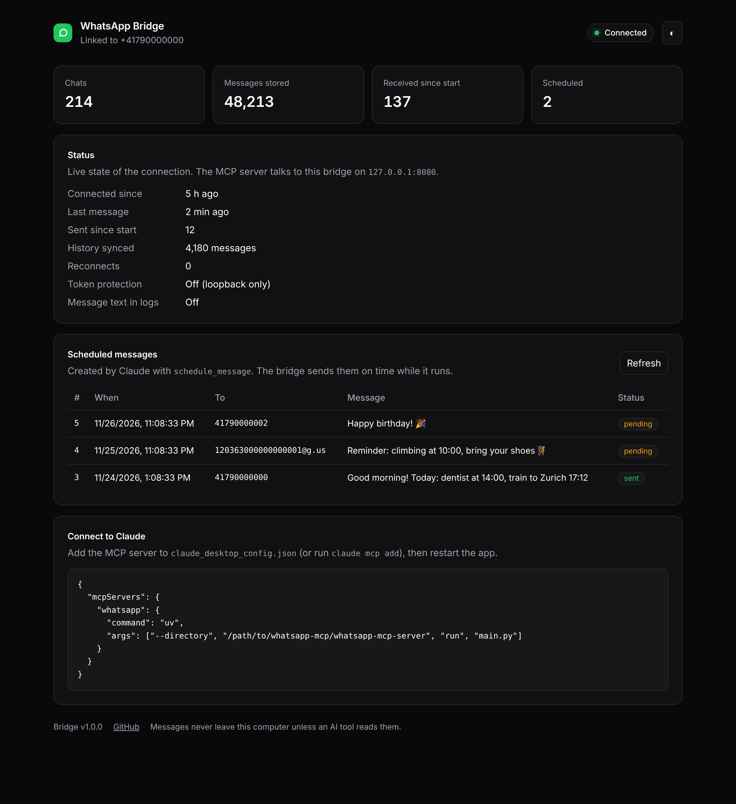

<div align="center">

# WhatsApp MCP

**Give Claude (and any MCP client) safe access to your personal WhatsApp.**
Search years of chats, get a "what did I miss?" digest, draft replies in your own style, react, schedule messages – all running locally on your computer.

[](https://github.com/Kmo187/whatsapp-mcp/actions/workflows/ci.yml)
[](LICENSE)




</div>

> This project is a maintained fork of [lharries/whatsapp-mcp](https://github.com/lharries/whatsapp-mcp) (MIT). It keeps every original tool and adds a security layer, 13 new tools, a web dashboard, a scheduler, Windows/Docker installers and a test suite. See [what's new](#whats-new-compared-to-the-original).

---

## Why

WhatsApp is where a lot of real life happens, but it has no API for personal accounts. This project links a small **bridge** to your account the same way WhatsApp Web does, keeps a **local SQLite copy** of your history, and exposes it to AI assistants through the [Model Context Protocol](https://modelcontextprotocol.io).

Ask Claude things like:

- *"What did I miss on WhatsApp today? Which chats still need an answer?"*
- *"When did Anna send me the address of the Airbnb?"*
- *"Draft a reply to the climbing group in my usual style – don't send it yet."*
- *"Remind me on WhatsApp tomorrow at 7:30 to take the train at 7:52."*
- *"Who writes the most in the family group, and at what time?"*
- *"Export my chat with Luca from last summer as Markdown."*

## Features

| | |
|---|---|
| 🔎 **Search everything** | Multi-word and "exact phrase" search, filters by chat, person, date, media type, sent/received. Results include message IDs for follow-up actions. |
| 📰 **Catch-up digest** | `catch_up` groups recent activity by chat and flags conversations **awaiting your reply**. |
| 💬 **Reply, react, read** | Quote-replies, emoji reactions, read receipts, plus text, images, video, documents and voice notes. |
| ⏰ **Scheduled messages** | The bridge sends them on time – no cloud service needed. Overdue messages are skipped instead of sent days late. |
| 📊 **Chat analytics** | Messages per person, busiest hours and weekdays, media counts, most active chats. |
| 📤 **Export** | Any chat as Markdown, JSON or TXT. |
| 👥 **Groups** | List groups, participants with names and admin status, check which numbers use WhatsApp. |
| 🖥️ **Dashboard** | Pair by scanning a QR code **in your browser**, see live status and scheduled messages. Dark & light mode. |
| 🛡️ **Safety guards** | Read-only mode, recipient allow-list, attachment folder allow-list, prompt-injection labelling, CSRF/DNS-rebinding protection, optional token. |
| 🧩 **MCP-native** | Tool annotations (read-only vs. sending), prompts for daily digests and drafting replies, works in Claude Desktop, Claude Code, Cursor and other clients. |

## How it works

```
┌──────────────┐  MCP (stdio)  ┌──────────────────┐  HTTP (127.0.0.1)  ┌──────────────────┐   WhatsApp Web   ┌──────────┐
│ Claude / any │ ────────────▶ │  MCP server      │ ─────────────────▶ │  Go bridge       │ ───────────────▶ │ WhatsApp │
│  MCP client  │ ◀──────────── │  (Python)        │                    │  (whatsmeow)     │ ◀─────────────── │          │
└──────────────┘               └────────┬─────────┘                    └────────┬─────────┘  multi-device    └──────────┘
                                        │ read-only                               │ writes
                                        ▼                                         ▼
                                     ┌────────────────────────────────────────────────┐
                                     │  store/messages.db  (SQLite, on your computer)  │
                                     └────────────────────────────────────────────────┘
```

1. **`whatsapp-bridge/`** (Go, [whatsmeow](https://github.com/tulir/whatsmeow)) links to your account as a companion device, stores messages in `store/messages.db`, runs the scheduler and serves a locked-down REST API + dashboard on `127.0.0.1:8080`.
2. **`whatsapp-mcp-server/`** (Python, official MCP SDK) reads the database **read-only** and calls the bridge for actions.

Your messages stay on your machine. They only reach an AI model when the assistant calls a tool – and your MCP client shows you every tool call.

## Quick start

### Windows (one command)

```powershell
irm https://raw.githubusercontent.com/Kmo187/whatsapp-mcp/main/scripts/install-windows.ps1 -OutFile install-windows.ps1
powershell -ExecutionPolicy Bypass -File .\install-windows.ps1
```

The script installs Git, Go, uv and a C compiler (via winget), builds everything, starts the bridge invisibly at login, registers the server in Claude Desktop (with a backup of your config) and opens the dashboard for the QR code. Restart Claude Desktop afterwards.

### macOS / Linux

```bash
git clone https://github.com/Kmo187/whatsapp-mcp.git
cd whatsapp-mcp
./scripts/install.sh            # builds the bridge, installs the server, prints your config
cd whatsapp-bridge && ./whatsapp-bridge
```

Open **http://127.0.0.1:8080**, scan the QR code (WhatsApp → *Settings → Linked devices → Link a device*), then add the printed block to your Claude Desktop config and restart it.

**Claude Code:**

```bash
claude mcp add whatsapp -- uv --directory /path/to/whatsapp-mcp/whatsapp-mcp-server run main.py
```

### Docker (bridge only)

```bash
cp .env.example .env            # set WHATSAPP_BRIDGE_TOKEN
docker compose up -d
```

Open `http://127.0.0.1:8080/?token=<your token>` to pair. Give the MCP server the same `WHATSAPP_BRIDGE_TOKEN`. Details in [docs/configuration.md](docs/configuration.md#docker).

<details>
<summary><b>Manual setup</b></summary>

Requirements: Go 1.26+, a C compiler (CGO is needed for SQLite), Python 3.11+, [uv](https://docs.astral.sh/uv/), optionally FFmpeg for voice messages.

```bash
cd whatsapp-bridge && go run .           # first start shows the QR code
```

`claude_desktop_config.json` (macOS: `~/Library/Application Support/Claude/`, Windows: `%APPDATA%\Claude\`):

```json
{
  "mcpServers": {
    "whatsapp": {
      "command": "/absolute/path/to/uv",
      "args": ["--directory", "/absolute/path/to/whatsapp-mcp/whatsapp-mcp-server", "run", "main.py"]
    }
  }
}
```

For Cursor use the same block in `~/.cursor/mcp.json`.
</details>

## Tools

**Reading** (marked read-only for your MCP client)

| Tool | What it does |
|---|---|
| `catch_up` | Activity since N hours / a date, grouped by chat, with `awaiting_reply` flags |
| `list_messages` | Search and filter messages (words, "phrases", chat, sender, dates, media, sent/received) |
| `list_chats` · `get_chat` | Chats with their latest message; filter direct/group |
| `search_contacts` · `get_direct_chat_by_contact` · `get_contact_chats` · `get_last_interaction` | Find people and their chats |
| `get_message_context` | The conversation around one message |
| `get_chat_stats` | Activity analytics for one chat or all chats |
| `list_groups` · `get_group_info` | Groups and participants |
| `check_whatsapp_numbers` | Which numbers are on WhatsApp |
| `download_media` | Save an image, video, audio or document and get its path |
| `get_bridge_status` | Connection health and active safety settings |
| `list_scheduled_messages` | Pending, sent, failed and cancelled scheduled messages |

**Acting** (marked as actions that reach the outside world)

| Tool | What it does |
|---|---|
| `send_message` | Text to a person or group, optionally as a quoted reply (`reply_to`) |
| `send_file` | Image, video or document with an optional caption |
| `send_audio_message` | Any audio file as a voice note (converted with FFmpeg) |
| `send_reaction` | Emoji reaction (empty emoji removes it) |
| `mark_as_read` | Blue ticks for a chat or specific messages |
| `schedule_message` · `cancel_scheduled_message` | Send later, cancel pending messages |
| `export_chat` · `request_chat_history` | Write a transcript file · ask your phone for older messages |

**Prompts:** `whatsapp_daily_digest`, `whatsapp_draft_reply`, `whatsapp_find`.

## Security

An assistant that can read private messages, sees text written by strangers and can send messages is exposed to the ["lethal trifecta"](https://simonwillison.net/2025/Jun/16/the-lethal-trifecta/): a crafted message could try to trick it into leaking data. This fork makes the risk controllable:

| Protection | Default | How |
|---|---|---|
| API only reachable from this computer | **on** | Bridge binds to `127.0.0.1`; refuses other addresses unless `WHATSAPP_BRIDGE_TOKEN` is set |
| Websites can't send messages through your bridge | **on** | JSON-only requests, Origin check (CSRF) and Host check (DNS rebinding) |
| Message texts labelled as untrusted | **on** | Results carry a note telling the model not to follow instructions inside messages |
| Database opened read-only by the MCP server | **on** | SQLite `mode=ro` |
| No private messages in log files | **on** | Logs show lengths, not text (`WHATSAPP_LOG_CONTENT=1` to change) |
| Safe file names for received documents | **on** | Path traversal (`../../`) is stripped |
| Read-only mode | off | `WHATSAPP_MCP_READ_ONLY=1` – no sending at all |
| Recipient allow-list | off | `WHATSAPP_MCP_ALLOWED_RECIPIENTS=41781234567,…@g.us` |
| Attachment folder allow-list | off | `WHATSAPP_MCP_ALLOWED_MEDIA_DIRS=/home/me/Share` |
| Token for the bridge API | off | `WHATSAPP_BRIDGE_TOKEN=…` (same value for bridge and MCP server) |

A safe setup for a "digest-only" assistant: `WHATSAPP_MCP_READ_ONLY=1`. A setup for reminders to yourself: `WHATSAPP_MCP_ALLOWED_RECIPIENTS=<your own number>`.

> This uses WhatsApp's unofficial multi-device protocol through whatsmeow, the same approach as other open-source WhatsApp clients. It is not affiliated with or endorsed by WhatsApp or Meta. Automated or bulk messaging can violate WhatsApp's terms and get numbers banned – use it for your own account and normal conversations.

## Configuration

All settings are environment variables. The most common ones:

| Variable | Used by | Default | Purpose |
|---|---|---|---|
| `WHATSAPP_BRIDGE_ADDR` | bridge | `127.0.0.1:8080` | Listen address |
| `WHATSAPP_BRIDGE_TOKEN` | both | – | Shared secret for the API |
| `WHATSAPP_STORE_DIR` | both | `whatsapp-bridge/store` | Session, history and media |
| `WHATSAPP_BRIDGE_URL` | server | `http://127.0.0.1:8080` | Where the server finds the bridge |
| `WHATSAPP_MCP_READ_ONLY` | server | `0` | Disable all sending |
| `WHATSAPP_MCP_ALLOWED_RECIPIENTS` | server | – | Comma-separated numbers / JIDs |
| `WHATSAPP_MCP_ALLOWED_MEDIA_DIRS` | server | – | Folders files may be sent from |

Full list, Docker notes and autostart examples: **[docs/configuration.md](docs/configuration.md)**. REST API reference: **[docs/api.md](docs/api.md)**.

## What's new compared to the original

- **Works with current WhatsApp** – updated whatsmeow (old versions are rejected by WhatsApp's servers), LID-address support so group senders show phone numbers and names.
- **Security** – localhost-only binding, CSRF + DNS-rebinding protection (the original API accepted cross-site requests from any website), optional token, read-only DB access, private logs, path-traversal-safe downloads, read-only mode and allow-lists.
- **Reliability** – fixed time-zone ordering bugs, chat timestamps no longer jump backwards during history sync, `print()` calls no longer corrupt the MCP stdio stream, pairing never times out, automatic re-pairing after logout, graceful shutdown.
- **More of your messages are searchable** – captions, polls, locations, contacts, edits, deletions, replies and reactions are stored.
- **13 new tools, 3 prompts, tool annotations**, a dashboard, a scheduler, Windows installer, Docker image, CI on Windows/macOS/Linux and ~50 automated tests.

Upgrading an existing installation keeps your session and history: the database is migrated in place.

## Development

```bash
make test     # Go tests (with -race) + pytest
make lint     # gofmt, go vet, ruff, mypy
make build
```

Contributions are welcome – see [CONTRIBUTING.md](CONTRIBUTING.md). Please report security issues privately ([SECURITY.md](SECURITY.md)).

## Troubleshooting

| Problem | Fix |
|---|---|
| Claude says the bridge is unreachable | Start the bridge (`bridge-starten.bat`, `./whatsapp-bridge` or Docker) and check http://127.0.0.1:8080 |
| `Client outdated (405)` in the log | WhatsApp updated its protocol. `git pull` and rebuild the bridge (Dependabot keeps whatsmeow current here) |
| QR code expired | It refreshes automatically on the dashboard – just scan the newest one |
| Messages missing after pairing | History arrives in the background; use `request_chat_history` for older messages of one chat |
| Logged out after ~20 days | Open the dashboard and scan the new QR code; the bridge re-pairs without a restart |
| Windows: `cgo: C compiler "gcc" not found` | Install a compiler (`winget install BrechtSanders.WinLibs.POSIX.UCRT`) and open a new terminal |
| Voice message fails | Install FFmpeg, or send the file with `send_file` |

## License

MIT – see [LICENSE](LICENSE). Original work © Luke Harries; fork © Kmo187 and contributors.
